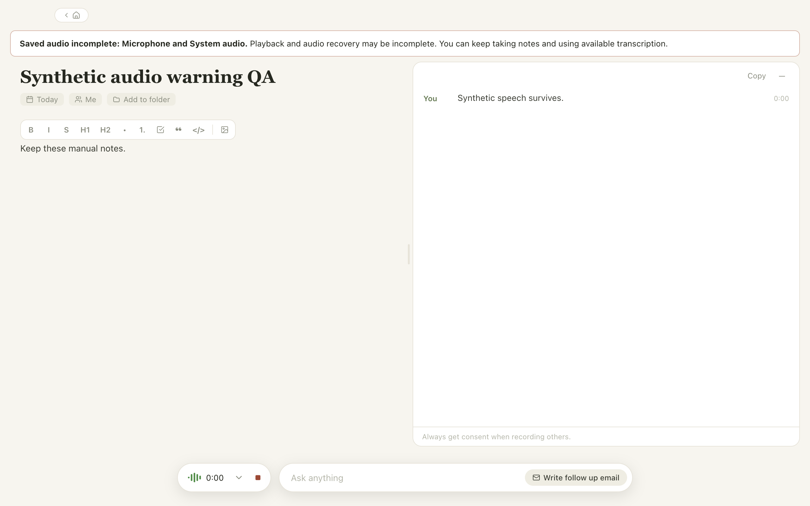
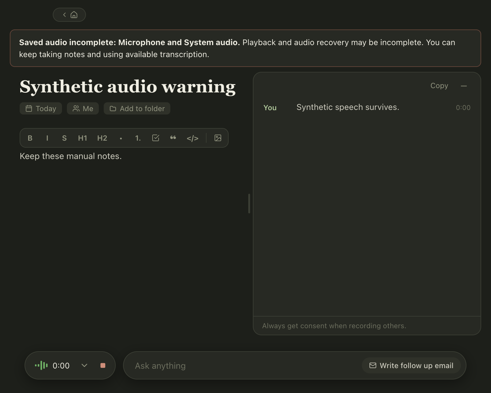
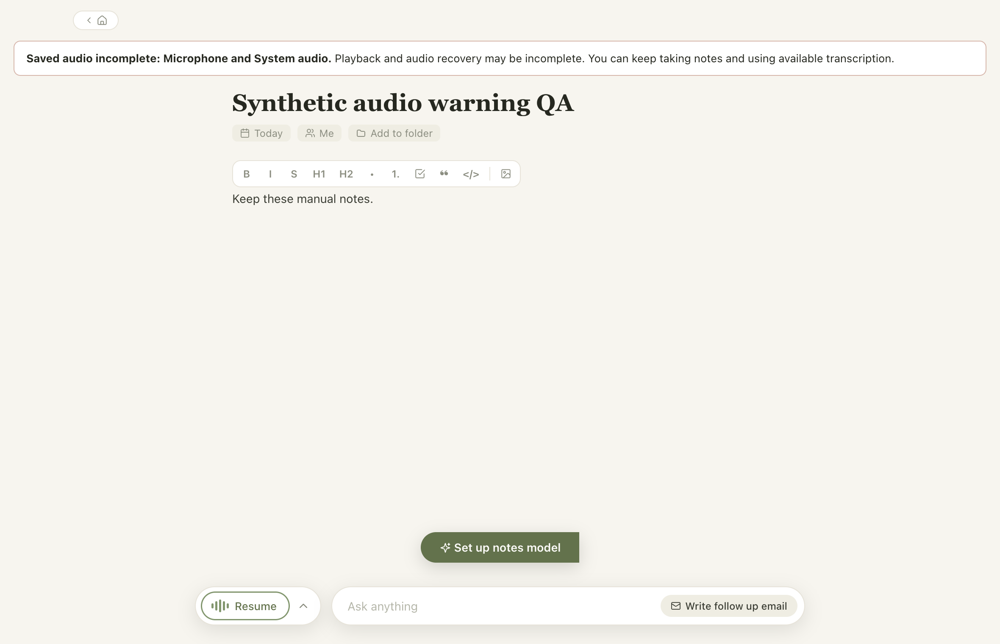

# DEV-504: saved-audio degradation

[Notion contract](https://app.notion.com/p/3fcf0f846ee481a3b678daec728dda68).
Synthetic verification on macOS 26.6.2 (25G83), Node 24.22.0, pnpm 10.33.2, Electron 44.0.0.
The PR records the exact tested commit. No Swift production code changed.

## Source contract

- `MeetingRecord.savedAudioFailures?: Partial<Record<'mic' | 'system', true>>` is additive metadata, with `SavedAudioFailures` exported from `@repo/meetings-store/types`. Absence means no observed save failure, **not** proof of complete audio. Normalization accepts only known channels with literal `true` values.
- `TranscriptSession` owns the same field for the current capture, exposes a defensive copy in snapshots, checkpoints it immediately on `audio_save_failed`, and includes it in transcript session backups. The meeting checkpoint merges historical flags, preserving earlier incomplete parts on Resume, re-transcription, and notes edits.
- Starting another capture resets current session flags. Starting another meeting does not inherit them. An explicit mismatched capture ID is rejected before broadcasting and by the session/renderer. Existing engine-host process guards reject superseded process callbacks; a scripted process regression verifies this. Untagged native events still rely on those existing host lifecycle guards.
- Generic transcribing, saved-audio, refinement or completion events cannot prove that previously missing frames were restored and **never clear** historical flags. There is currently no supported full-audio restoration event; do not invent one or clear flags on writer recovery.
- Main removes raw writer diagnostics before IPC. Renderer copy is fixed, source-specific and separate from transient lifecycle text. Related transcript persistence errors also use fixed copy, leaving diagnostics in main logs.
- No migration, source revision change, transcript replacement, audio rewrite, or cloud-policy change. Old records remain valid. Rolling back restores old behavior; older clients may drop this additive metadata on rewrite. Original audio/text are unaffected.
- If storage cannot accept even the metadata checkpoint, the in-memory warning remains and the existing transcript-save error is surfaced. Persistence after process exit cannot be guaranteed while all writes fail; freeing storage and successful later checkpoints are required.

## Automated evidence

The relevant baseline had 13 passing tests. The new persistence regression failed on the old implementation (`savedAudioFailures.mic` was undefined) and passes after the fix.

- Frozen-lockfile install: passed. Package manager retained its configured ignored native build scripts.
- Desktop: 366 passed, 8 skipped, 0 failed (374 total); node/renderer typechecks and production build passed.
- Meetings store: 19 passed; typecheck passed.
- Workspace lint and production audit passed (no known vulnerabilities).
- Web typecheck and MCP tests are reported in the PR with exact results.
- The eight desktop skips are six native audio-import checks requiring the Swift engine/fixture, one native Whisper/model check, and Windows-only PCM recovery. They are not native acceptance passes.
- One intermediate full run hit the existing `signals immediately when no session is finishing` two-second process timing limit while Electron QA was launching. The focused process suite (7 tests) and subsequent full desktop run passed without changing that limit.

## Isolated desktop UI QA

```sh
pnpm --filter desktop build
DOODLE_PLAYWRIGHT_MODULE=/path/to/playwright/test \
  node apps/desktop/scripts/test-saved-audio-warning.cjs
```

The harness uses a new temporary `DOODLE_USER_DATA` profile and the built app's real main, preload, meeting storage and renderer. Only the capture engine is replaced with synthetic events. It intercepts engine process spawns, disables automatic note generation in the synthetic profile, and never records hardware or reads personal meetings. Evidence paths are printed on each run. It removes `ELECTRON_RUN_AS_NODE` from the launched Electron environment when inherited from an agent host.

Passed: mic-only failure, both-source failure while transcript is hidden, ongoing speech segments, no private reason/path in renderer IPC, main snapshot reattachment, Stop via focused Enter, preserved notes and text, Resume without clearing historical flags, stale previous-capture rejection, full app relaunch persistence, and a fresh meeting with no warning. Inspected 1280×800 light and the supported 800×640 minimum-width dark window. The polite status has no dismiss action or focus trap and does not overlap Stop.





## Check this before release

- In a disposable library on a constrained test volume, make the actual native writer fail for mic and system separately. Expect source-specific warning, continuing useful transcription and usable Stop; never fill a personal disk.
- Restore sufficient space, Stop, reopen and relaunch. Expect warning retained, existing transcript/manual edits retained, and inspect/play each actually saved part. Compare missing frames with native diagnostics; synthetic events do not validate playable parts or native disk-full behavior.
- Resume the affected meeting: earlier incomplete audio must remain flagged. Start a fresh successful meeting: no inherited warning.
- In the packaged Mac candidate at wide/minimum sizes and both themes, use keyboard Stop and VoiceOver. Expect readable warning announced without stealing focus, and accessible notes/Stop.
- Human review, required CI/CodeQL, signed packaged Mac acceptance and the above native writer checks remain gates. Windows native QA follows Mac acceptance in the parent release lane. This PR does not publish, merge, or claim native QA complete.
