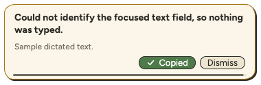

# DoodleNote 1.0.1 release preparation

Status: reviewed source merged; exact signed/notarized candidate installed and tested. The publication PR promotes its static updater manifest and release date.

## Scope

- Plain Bark dictation resolves the currently selected field at delivery. Selection rewrites and Undo keep their original target guards. Current password fields remain protected and uncertain insertions are never retried automatically.
- Focus resolution checks both system and application accessibility focus, follows explicit focused descendants, and briefly waits for a cold web accessibility tree. Global secure keyboard input has its own recovery message.
- Compact message cards have a ten-second countdown paused by hover or an outstanding copy. Successful Copy shows a centered checkmark and Copied for 450 ms, then fades for 120 ms. Failed copies remain retryable. Hover and press feedback respect reduced motion.
- Resting and active waveform pills follow the pointer's monitor every 150 ms. Message cards stay on their opening monitor so their controls stay reachable.
- Local Dev packaging reuses its previous Apple Development signer to preserve macOS permission grants. Production signing configuration is unchanged.
- Integrated onto current main without removing Only My Voice, shortcut customization, or 1.0.0 security hardening. The website changelog stays Unreleased until publication.

## Verification

- Frozen-lockfile installation passed.
- Desktop typechecks and suite: 1,012 passed, 8 skipped, zero failures.
- Native Swift suite: 95 passed, zero failures.
- Web typecheck and workspace lint passed.
- Electron popup QA confirmed compact layout, countdown hover pause, copy feedback, and successful-copy dismissal while hovered. Monitor transitions were checked in controller tests with two simulated displays, in both directions and on all three dock edges.
- The local Dev app was tested interactively during development, and its microphone, Accessibility, and Input Monitoring grants survived signed rebuilds. This is not a test of a production-signed 1.0.1 installer.
- An intermittent unconfirmed paste was observed during development but could not be reproduced. No additional speculative insertion retry was introduced.

## Signed candidate and hands-on verification

- Source PR [#286](https://github.com/Onyx-Dev-Labs/doodle-note/pull/286) was approved by Sean and merged as `d846a176bb1c4f744d9c6a463cd7fc6e865a030d`.
- [Mac candidate run 43302498859](https://github.com/Onyx-Dev-Labs/doodle-note/actions/runs/43302498859) passed production signing, notarization, stapling, Gatekeeper, manifest validation, and ZIP/DMG equality checks. The artifact was retained and promoted without rebuilding.
- Local verification on macOS 27.2 ARM64 passed archive provenance/hash, receipt hashes, signatures/tickets/Gatekeeper, ZIP/DMG equality, audio import/merge/failure preservation, packaged native modules, worker/MCP smoke, and unchanged bundle/original checks.
- The separate [macOS 14 check](https://github.com/Onyx-Dev-Labs/doodle-note/actions/runs/43306499080) could not start: GitHub reported `macos-14-arm64-us-default` is unsupported. This is environment-blocked, not a compatibility pass.
- Alec installed the exact signed 1.0.1 app, tested it, reported it working well, and explicitly authorized publication on November 12, 2026. This does not establish prior-version in-app updater/relaunch acceptance.

SHA-256 of retained payloads:

- ZIP: `20c3fdd28ea72663c687ceff37cda483c7da31b5446272162cbfaaace676ba01`
- DMG: `58b7523c62f7219dbc3861d4d2961408ce4e242cca28f0a9eee639bb1e39f26a`
- Manifest: `e034e5cacbf827ee94af2f3f49d4c64ad124edad20552044290c77275291436c`

## Publication verification

The [GitHub 1.0.1 release](https://github.com/Onyx-Dev-Labs/doodle-note/releases/tag/v1.0.1) is public with the exact ZIP, DMG, manifest, and receipt. The tag resolves to the approved source commit. The Blob feed was read back independently and matched the candidate manifest hash.

The receipt-bound publisher completed successfully with `activated: true`, verified full public artifact bytes on both storage and website routes, and retained rollback evidence. This PR copies the static feed byte-for-byte from its successful `stagedManifest` output for separate review and deployment. Verify the production feed, changelog, download route, and updater behavior after deployment. See [RELEASING](../RELEASING.md). Windows feeds are unchanged.
