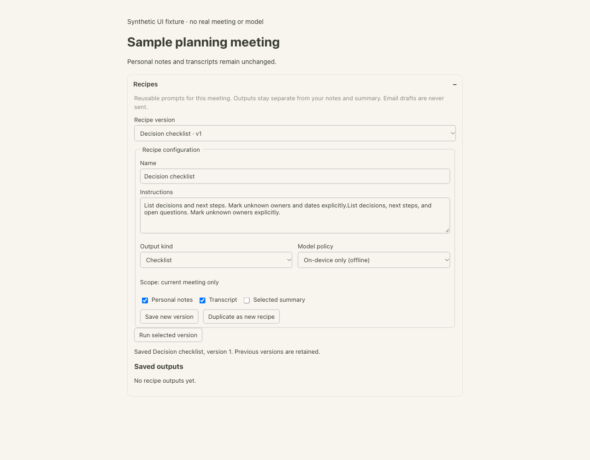
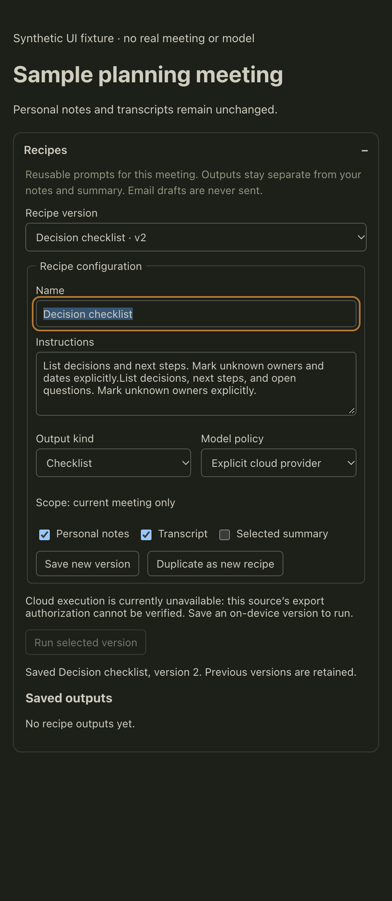

# Single-meeting recipes (DEV-510)

Meeting → Recipes creates a named local prompt with immutable versions. Saving edits
adds a version; Duplicate creates a new recipe. Select any saved version and run it
against this meeting's declared personal notes, transcript, and/or selected summary.
Outputs are separate, retained artifacts. Export downloads Markdown with provenance;
email output is an unsent draft. No action replaces an original or sends an email.

## Storage and compatibility

`<library>/recipes-v1.json` is an additive, versioned local file containing `versions`
and completed `outputs`. Each output includes its unique run ID, complete immutable
recipe snapshot, meeting ID, original-source SHA-256 revision, source scope and input
kinds, captured/start/completion timestamps, model ID/revision and Markdown. A repeated
completed run ID returns that artifact, never a second generation. Explicit reruns
have new IDs and retain previous outputs. Failed/canceled attempts commit nothing.

Source revision is SHA-256 of the exact authoritative meeting JSON read at start and
again before commit. It includes richer metadata, scope, manual changes and session
changes; it is **not** DEV-506's projected source revision or a factual citation.
Manual participant names are used, and richer selected-summary identity takes
precedence over legacy enhanced Markdown. A missing selected summary errors instead
of substituting an older summary. Originals are only read, never normalized/written.

Model revision currently records the catalog model URI/ID plus local artifact size
and modification time. This is a local artifact fingerprint, not a cryptographic
weight digest or guarantee of identical wording. Hosted model revision metadata is
not an immutable provider snapshot; cloud execution is disabled as described below.

Writes use a private temporary file, fsync, and atomic rename. Malformed/unsupported
files fail visibly without resetting data; unknown top-level fields are preserved.
No recipe sync, backup-format migration, deletion or external integration is added.
The explicit `LIBRARY_ENTRIES` relocation allowlist includes `recipes-v1.json`;
tests verify exact copy, restart and retained originals. Historical output scope is
preserved after relocation or canonical identity initialization, not rewritten.
Rollback can revert code while retaining the sidecar for later recovery. An older
binary will ignore recipes, but its old relocation allowlist does not copy this new
file: manually preserve it before relocating with an older binary.

## Library and policy boundaries

Only the main-owned active library and current meeting are used. Renderer arguments
cannot supply a path. All three scope fields and canonical root path are checked at
start and completion; source revision, source ownership, trash and availability are
rechecked before the synchronous artifact commit. There are no cross-library inputs.
The existing library-operation barrier includes the entire run; owner/run-scoped
Cancel bypasses that barrier, including a run queued behind relocation. Reload/crash,
unmount, unsaved editor changes, timeout and explicit Cancel abort the producer and
wait for cleanup. Existing summary/Ask busy ownership prevents concurrent model use.

The small read-only `recipe-library.ts` adapter matches DEV-506's canonical
`meetings/.doodlenote-source-library.json` and legacy realpath SHA-256 identity. It
never creates a UUID/marker. Legacy records without sourceScope remain eligible
under local null/null scope; explicit mismatches/malformed ownership fail closed.
A newly initialized identity invalidates an in-flight legacy fence. **Integration
follow-up:** after PR #223 is integrated into this stack, replace the read-only adapter
with `@repo/meetings-store/sources.localSourceScope` / `sameScope`; retain the path
fence and equivalence fixtures. This PR is stacked only on DEV-505 and does not
import unavailable DEV-506 APIs or claim that dependency has landed.

Local-only always selects an on-device model, regardless of global cloud selection;
missing models produce an actionable error with no network/provider fallback. No
model download is triggered by Run. After model setup this path works without a
network/account; native offline inference remains a manual qualification gate.

Explicit-cloud versions may be stored, edited and duplicated, but **cloud recipe
execution is currently unavailable for every source**. This base has no trustworthy
per-meeting export-authorization API. Missing provenance flags, a local sourceScope,
sign-in, recipe policy, and per-run consent are not proof of export permission.
Main rejects before selecting/calling a provider, and the UI explains how to save
an on-device version. Enabling cloud requires a future authoritative authorization
contract plus configured provider/data-policy and per-run consent; this PR does not
infer permission or introduce guessed provenance fields.

## Bounded generation

Additive optional `NotesEngine.runBounded(system, prompt, control)` retains the entire
request or rejects it before inference. It reuses DEV-505's actual local allocation,
resolved chat wrapper/tokenizer, output reserve and conservative supported provider
budget contracts. It never silently truncates the recipe or declared inputs. Limits,
abort signals, output-limit failures and context disposal are preserved. Built-in
summary templates, global Ask assembly and auto-generate-after-Stop are unchanged.

## Evidence and native QA

Automated synthetic coverage includes version/restart persistence, duplicate/rerun
identity, failed/canceled/late results, busy cleanup, wrong cancel owner, source edit,
trash/scope/path/identity changes, queued cancellation, missing richer selected summary,
unknown-file fields/corruption, relocation and cloud refusal before generation.
Adapter tests cover Unicode/exact boundaries, missing policy, unsupported/oversized
models, exact wire input/output reserve and allocated local context cleanup.

The real RecipePanel was exercised in an isolated browser fixture with synthetic IPC
(no native inference): create, edit into v2, duplicate, missing-model error/retry,
successful output display and Markdown/provenance download. At 1280×1000 light and
480×1100 dark, labels/readable states fit without horizontal overflow; Tab moves from
version selector to Name with a visible focus outline. These images are component
smoke evidence, not installed-app acceptance:




Check this in an isolated synthetic desktop profile:

```sh
DOODLE_USER_DATA=/tmp/doodlenote-dev510-qa pnpm --filter desktop dev
```

- With a cached on-device model, create/edit/duplicate a recipe, restart, select v1,
  run offline, rerun, and export. Previous outputs and original notes/transcript/
  selected summary must remain intact; provenance must identify the chosen version.
- Cancel during preparation and decoding, then retry after cleanup. Edit source text
  mid-run; no stale result should save. Missing model and oversized input must offer
  actionable errors without a hosted request or incomplete artifact.
- Select explicit-cloud: save succeeds, run is unavailable with use-local guidance.
  Repeat with global Settings configured for cloud; local-only still stays on device.
- Move the library with the existing relocation UI and restart; recipe versions,
  outputs and originals must survive. Test keyboard focus, narrow/wide and light/dark
  layouts in the actual MeetingView, then verify ordinary Stop auto-summary behavior.

Record packaged SHA and macOS version. Parent/Sean own packaged/native inference QA,
code-owner approval and CI/CodeQL gates. Windows native QA follows macOS; no signing,
merge, publication or native pass is claimed by these automated/component checks.
